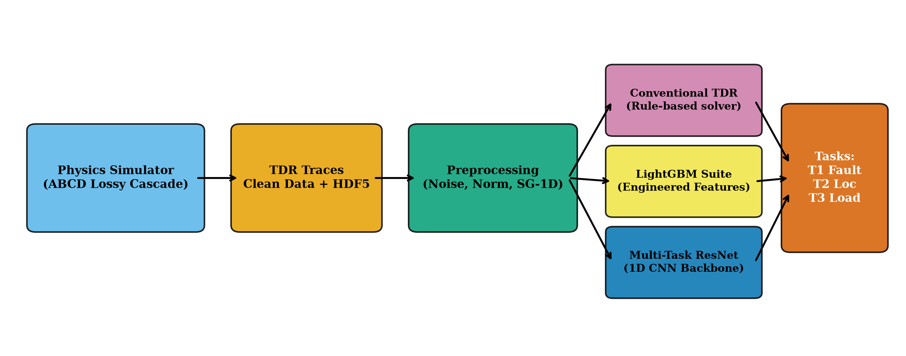

# Machine-Learning-Based Transmission Line Fault and Load Identification via Time-Domain Reflectometry (TDR)

**Course:** EE 305 Electromagnetic Waves, Indian Institute of Technology Indore (IIT Indore)  
**Theme 4:** Machine-Learning-Based Transmission Line Fault and Load Identification  
**Author:** Shlok Parikh (Department of Chemical Engineering, IIT Indore)  
**Deliverables:** Complete tested codebase and IEEE-style conference research report (`report/main.tex`).

---

## 1. Problem Statement & Physics Background

Time-Domain Reflectometry (TDR) is the benchmark non-destructive diagnostic technique for transmission lines, coaxial cables, and distributed wiring networks. A high-speed voltage step is injected into a lossy coaxial line (RG-58-like) through source resistance $R_g$, and the input terminal voltage $V(0, t)$ is recorded over time.

Every impedance discontinuity along the line reflects a fraction of the propagating electromagnetic wave according to the local voltage reflection coefficient:
$$\Gamma = \frac{Z - Z_0}{Z + Z_0}$$
The reflected wave returns to the sending terminal at round-trip time:
$$t = \frac{2d}{u} = \frac{2d}{v_f c}$$
where $u = v_f c \approx 1.98 \times 10^8$ m/s ($v_f \approx 0.66$ in polyethylene). In lossy lines, high frequencies suffer from conductor skin effect ($R(f) = R_{\text{dc}} + k_{\text{skin}}\sqrt{f}$) and dielectric loss ($G(f) = 2\pi f C \tan\delta$), causing dispersion, attenuation, and smearing of sharp wave edges.

From a single raw TDR trace, this system simultaneously solves three coupled diagnostic tasks:
| Task | Nature | Output Description |
|---|---|---|
| **T1: Fault Classification** | 7-class | `none`, `short`, `open`, `shunt_R`, `shunt_C`, `series_R`, `z0_section` |
| **T2: Fault Localization** | Regression | Fault position as fraction of cable length $d/l \in [0, 1]$, reported in metres |
| **T3: Load Identification** | 6-class + Regression | Load class (`open`, `short`, `matched`, `R`, `RL`, `RC`), termination resistance $R_L$ ($\Omega$), and reactive parameters: $L$ ($\mu\text{H}$) for $RL$ or $C$ (nF) for $RC$ |

### Fundamental Physics Masks
- **$T_2$ Masking:** For pristine cables (`none`), no fault discontinuity exists; $T_2$ localization is physically undefined and masked during both training and evaluation.
- **$T_3$ Masking:** For hard faults (`short` or `open`), the discontinuity reflects 100% of the wave energy ($\Gamma = \pm 1$); downstream cable segments and the terminal load are completely unobservable and masked during both training and evaluation.

---

## 2. End-to-End Pipeline



1. **Exact Physics Simulator (`tdr/simulator.py`):** Solves the lossy telegrapher's equations in the frequency domain via analytical two-port cascade matrix transformations ($N_{\text{sim}} = 8192$ points), synthesized via inverse FFT without grid dispersion.
2. **Unified Preprocessing (`tdr/data.py`):** Normalizes voltage to the incident plateau ($\tilde{v} = v/v_{\text{inc}}$), computes the smoothed numerical first derivative ($d\tilde{v}/dt$) using a 1D Conv Savitzky-Golay FIR filter, and appends a dimensionless coordinate channel ($t/T_{\text{nom}}$), outputting a $[3, 1024]$ tensor.
3. **Multi-Model Diagnosis:**
   - **Conventional TDR (no ML):** robust noise estimate, edge detection with a median-difference step test, hard faults from the level after the edge relative to before it, soft faults from edge shape, load by DC de-embedding $Z_{in} = Z_0 L_{end}/(2-L_{end})$; all thresholds tuned on the validation split.
   - **LightGBM:** Four gradient boosted tree ensembles trained on 94 engineered physics features.
   - **Multi-Task 1D-ResNet:** convolutional stem, 4 residual stages (32, 64, 128, 128 channels), flattened $128\times64$ feature map (keeps time position for location) projected to a 256-d shared embedding, and 4 task heads trained with a physics-masked multi-task loss (AdamW, warm-up + cosine, mixed precision on GPU, fresh noise every batch).

---

## 3. Repository Map

```
EM_WAVES_PROJECT/
├── antigravity.md              # Project memory, status log, decisions log, and instructions
├── README.md                   # Complete repository documentation and guide
├── requirements.txt            # Python dependencies (CPU-only PyTorch, LightGBM, Streamlit, etc.)
├── config.yaml                 # Single source of truth for simulation and model parameters
├── .gitignore                  # Git exclusions (checkpoints, full datasets, venv)
├── tdr/                        # Core Python library
│   ├── __init__.py             # Package exports
│   ├── simulator.py            # Exact frequency-domain lossy transmission line cascade simulator
│   ├── data.py                 # Dataset generator, preprocessing, PyTorch dataset, and real data parser
│   ├── features.py             # Conventional TDR rule-based solver and 94-feature extractor
│   ├── models.py               # LightGBM suite and Multi-Task 1D-ResNet architecture
│   └── metrics.py              # Physics-masked evaluation metrics for T1, T2, and T3
├── 1_validate_simulator.py     # Physics and bounce-diagram simulator validation
├── 2_generate_data.py          # Synthetic dataset generator CLI
├── 3_train.py                  # Model training script (LightGBM and ResNet1D)
├── 4_evaluate.py               # Complete evaluation suite covering E1–E8 experiments
├── 5_make_figures.py           # Publication-grade figure generator (all 16 figures)
├── run_all.py                  # Master pipeline orchestrator (--mode quick/full, --device cpu/cuda)
├── app.py                      # Interactive Streamlit application (simulation and CSV upload)
├── tests.py                    # 15 physics, simulator, pipeline and baseline-acceptance tests
├── kaggle_run.ipynb            # Self-contained notebook to run full training on Kaggle GPU
├── data/
│   ├── README.md               # Synthetic and real dataset documentation
│   ├── dataset_card.md         # Full dataset specifications, splits, and parameter bounds
│   └── real/wise_casing/       # Real NREL/LBNL laboratory coaxial cable TDR measurements
├── results/
│   ├── LOG.md                  # Execution and evaluation log with git hashes and metrics
│   ├── tables/                 # Generated tables (CSV, Markdown, and booktabs LaTeX)
│   ├── experiments/            # Raw JSON experiment outputs (E1–E8)
│   └── runs/                   # Model training configs, histories, and predictions
├── figures/                    # 16 publication figures (300-dpi PNG and vector PDF)
├── app/weights/                # Exported deployment model weights for the Streamlit app
└── report/                     # IEEE-style conference research report
    ├── main.tex                # Root LaTeX document (IEEEtran conference class)
    ├── refs.bib                # BibTeX references
    ├── README.md               # Overleaf compilation instructions
    ├── sections/               # Sections 1 to 7 (Theory, Methods, Results, Discussion)
    ├── figures/                # Pre-synchronized vector PDF figures
    └── tables/                 # Pre-synchronized booktabs LaTeX tables
```

---

## 4. Quick Start: Local Run, Tests & Streamlit App

### Prerequisites
- Windows OS with PowerShell
- Python 3.11

### 1. Setup Virtual Environment
```powershell
python -m venv .venv
.\.venv\Scripts\Activate.ps1
pip install torch --index-url https://download.pytorch.org/whl/cpu
pip install -r requirements.txt
```

### 2. Run the Unit Test Suite (15 Tests)
```powershell
pytest -q tests.py
```
Validates causality, DC limits, characteristic impedance, attenuation, bounce diagrams, reactive tails, $Z_0$ bump widths, dataset integrity, preprocessing determinism, and multi-task loss masking.

### 3. Run the End-to-End Pipeline Locally (Quick Mode)
```powershell
python run_all.py --mode quick --device cpu
```
This generates the quick dataset (4,500 samples), trains Conventional, LightGBM, and ResNet models, runs ablation and learning curve runs, evaluates E1–E8 experiments, generates all 16 figures, and exports deployment weights to `app/weights/`.

### 4. Launch the Interactive Streamlit App
```powershell
streamlit run app.py
```
- **Tab 1 (Interactive Simulation):** Configure cable length, $Z_0$, loss, rise time, fault type/location/value, load type/values, and SNR. Plots the simulated trace with a dual distance/time axis, compares all three models, and displays ResNet class probabilities.
- **Tab 2 (Upload CSV):** Upload a step-type TDR trace (`time_s,voltage_v` or `Time(us),Amplitude(mV)`) for automatic resampling and diagnosis. The models are trained on step responses; pulse-type records (such as WISE-CASING) are out of their domain.

---

## 5. Full Pipeline on Kaggle GPU

To train on the full 85,000-sample dataset across multiple seeds:
1. Push your local repository to a private or public GitHub repo:
   ```powershell
   git remote add origin https://github.com/<USERNAME>/tdr-fault-load-ml.git
   git push -u origin master
   ```
2. Open [Kaggle](https://www.kaggle.com/), create a new Notebook, and import or paste `kaggle_run.ipynb`.
3. Set **Accelerator = GPU (T4 or P100)** and **Internet = On**.
4. Update `REPO_URL` in Cell 2 with your GitHub repository URL.
5. Run all cells:
   - Cell 1: Explains required settings.
   - Cell 2: Clones the clean repository.
   - Cell 3: Installs lightweight dependencies and verifies CUDA.
   - Cell 4: Runs `pytest -q tests.py`.
   - Cell 5: Executes `python run_all.py --mode full --device cuda --skip-existing`.
   - Cell 6: Compresses outputs into `/kaggle/working/outputs.zip` and prints key metrics.
6. Download `outputs.zip` from Kaggle and unzip it into your local repository root to restore full model weights, tables, and figures in place:
   ```
   tar -xf outputs.zip
   ```
   (PowerShell alternative: `Expand-Archive -Path outputs.zip -DestinationPath . -Force`)

**Full run on Kaggle (estimate; the measured per-stage wall-clock is written to `results/timings.json`):**
- Dataset generation (85k samples): a few minutes
- LightGBM: 3 seeds + 4 learning-curve runs, features computed in parallel and cached: ~30–60 min
- ResNet1D: 3 seeds + 4 learning-curve + 5 ablation runs, ≤40 epochs each with early stopping, on-GPU noise/preprocessing: ~1–1.5 h on a T4
- Evaluation (E1–E8) and figures: ~10 min
- **Total:** roughly 2–3 hours, well within Kaggle's 12-hour limit.

---

## 6. Experimental Results Summary

Main comparison on the test split at 30 dB SNR (`results/tables/main_comparison.md`, generated by `4_evaluate.py`):

| Model               |   Fault Acc (%) |   Fault Macro-F1 |   Loc MAE (m) |   Loc Median (m) |   Loc P90 (m) |   Loc <1m (%) |   Load Acc (%) |   Load Macro-F1 |   MAPE R (%) |   MAPE L (%) |   MAPE C (%) |
|:--------------------|----------------:|-----------------:|--------------:|-----------------:|--------------:|--------------:|---------------:|----------------:|-------------:|-------------:|-------------:|
| Conventional TDR    |            62.2 |           0.6114 |          9.34 |             0.96 |         36.68 |          50.8 |          78.21 |          0.7949 |         34.1 |        169.5 |        139.2 |
| LightGBM            |            69.8 |           0.7026 |          9.32 |             2.12 |         30.01 |          33.3 |          85.2  |          0.8525 |         19.7 |         26   |         50.9 |
| Multi-Task ResNet1D |            56.8 |           0.5532 |         19.79 |            14.98 |         44.48 |           3   |          65.08 |          0.6412 |        110.3 |         53.1 |         89.5 |

*These numbers are from the **quick** smoke-test run (3,000 training samples, 3 epochs) and only show that the pipeline works; they are replaced by the full Kaggle run (60,000 samples, 3 seeds, mean ± std). Detection limit vs reflection strength: `results/tables/recall_vs_gamma.md`. Real-data physics check: `results/tables/real_data.md`.*

---

## 7. Data Description, Reproducibility & Credits

### Synthetic Dataset
Full dataset specifications and parameter distributions are documented in [`data/dataset_card.md`](data/dataset_card.md). All random number generators (NumPy and PyTorch) are strictly seeded from `config.yaml`. Running the pipeline with identical seeds produces byte-identical traces and reproducible metrics.

### Real Laboratory Dataset: WISE-CASING (physics check)
- **Citation:** Y. Wu and J. Wang (Lawrence Berkeley National Laboratory), *WISE-CASING: Time Domain Reflectometry Data from Lab Experiment on Coaxial Cable*, Geothermal Data Repository, submission 1164, 2018. DOI [10.15121/1559012](https://doi.org/10.15121/1559012). Licence and terms: see <https://gdr.openei.org/submissions/1164>.
- **Documented setup:** 80 m RG-85 coax, shorted termination, undamaged and with a 120° shield cutaway at 40 m; plus records documented as 20 / 10 / 5 m cables (verbatim quotes in `data/real/wise_casing/labels.yaml`).
- **How it is used (E8):** the records are *pulse-type* TDR, not step responses, so the step-trained models are not applied. Instead `tdr.data.analyse_real_wise_casing` measures echo round-trip times, estimates the velocity factor from the undamaged 80 m record, and locates the cutaway by echo-time ratio. On the quick run this gives vf ≈ 0.64 and a cutaway estimate of 38.5 m (documented: 40 m). The 20 / 10 / 5 m records' echo times are inconsistent with their documented lengths and are flagged. See `data/README.md`, `results/tables/real_data.md` and `figures/fig_real_data.png`.

---

## 8. IEEE Conference Report

The research paper is written in LaTeX using the standard `IEEEtran` conference template in `report/`:
- `report/main.tex`: Root document.
- `report/sections/`: Complete Theory, Simulation, Methodology, Experimental Protocol, and Results sections.
- `report/figures/`: Pre-synchronized vector PDF figures.
- `report/tables/`: Pre-synchronized booktabs LaTeX tables.
- `report/refs.bib`: Complete BibTeX references.

To compile on **Overleaf**, simply upload the `report/` folder and click **Recompile**.
